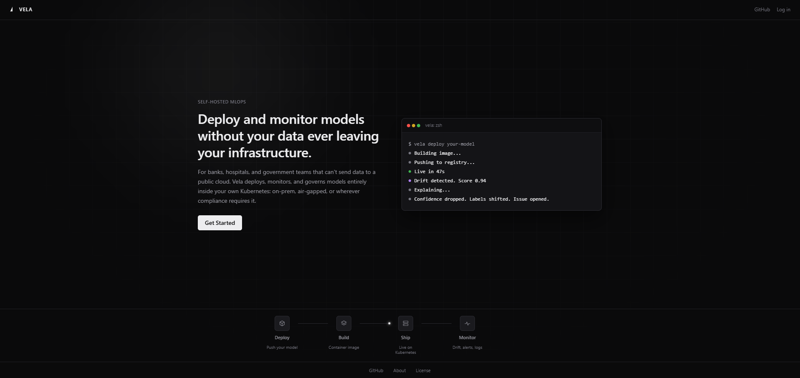
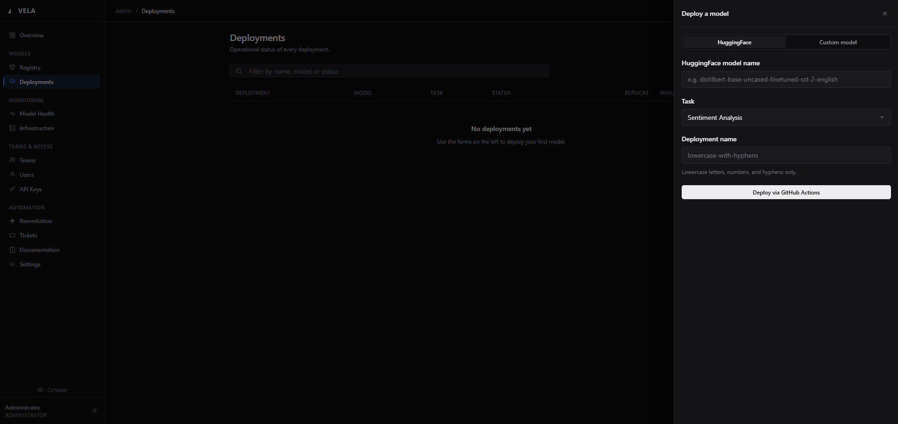
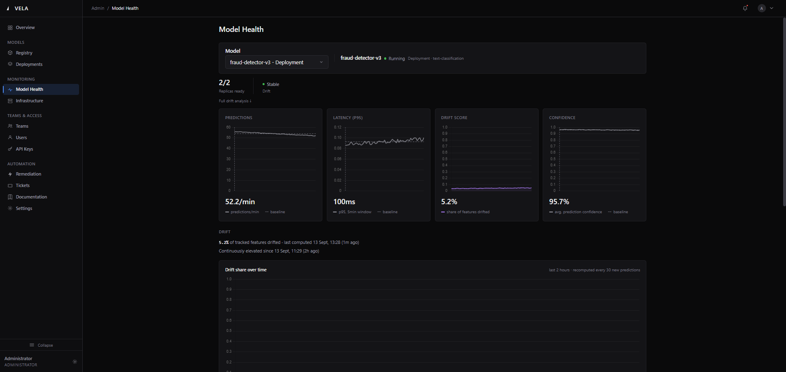

# Vela

Open-source MLOps for regulated industries. Deploy any model, detect drift, understand why, on your own infrastructure.



## Why Vela

A data scientist deploys a model on Friday. By Monday the data, the behavior or the confidence has changed, and nobody notices until a business metric drops weeks later.

Vela watches your models continuously, flags changes, and explains them in plain language, on your own servers. No data leaves your network. It is built for hospitals, banks, universities and government agencies that cannot use HuggingFace Spaces or cloud ML services.

## What it does

### Deploy

Submit a HuggingFace model name or upload your own weights. GitHub Actions builds a multi-arch Docker image and deploys it to Kubernetes. Live in 5 to 10 minutes.



### Monitor and explain

Prometheus scrapes metrics every 15 seconds. Evidently AI computes statistical drift over a sliding window and tracks which signals shifted: confidence score, label distribution, input length. Redis keeps state across restarts.

When drift is detected, an LLM writes a plain-language summary naming the drifted columns and their p-values. Not just "drift detected", but "your confidence score and label distribution have both shifted significantly since the deploy 2 hours ago, while latency remains stable."



### Act

When drift crosses a threshold you set, Vela opens a GitHub issue, fires a webhook, or triggers a retraining pipeline. Nobody has to notice first.


### Control

Multi-tenant workspaces with JWT auth. Teams with role-based model permissions. An access request and approval flow. API keys scoped to specific teams and models.

## How it works

Deployment loop, once per model:

```
Dashboard form -> GitHub Actions -> Docker build (arm64) -> Registry push -> kubectl deploy -> Live endpoint
```

Operations loop, continuous:

```
Prometheus scrape -> Evidently drift detection -> Event correlation -> LLM explanation -> Dashboard (30s refresh)
```

## Quick start

Run locally with Docker:

```bash
git clone https://github.com/HassanFasseh/vela
cd vela
cp .env.example .env
# Fill in GROQ_API_KEY and GEMINI_API_KEY
docker compose up
```

Open `http://localhost:8000/login`.

## Deploy to Kubernetes

**Helm (recommended).** One command, every setting in `values.yaml`:

```bash
helm install vela ./helm/vela \
  --set secrets.groqApiKey=gsk_... \
  --set secrets.githubToken=ghp_... \
  --set database.password=secure_password \
  --set minio.rootPassword=secure_password
```

Full reference: [`helm/vela/README.md`](helm/vela/README.md).

**Raw manifests.** The manifests the chart is built from:

```bash
kubectl apply -f k8s/
```

**Oracle Cloud (OKE, Always Free).** Requires an Oracle Cloud account, Terraform, kubectl and Docker with buildx.

```bash
cd terraform
terraform init
terraform apply
```

Then add your GitHub Actions secrets and push. CI/CD builds and deploys.

## API

### Authenticated prediction

```bash
curl -X POST http://your-vela/api/v1/predict \
  -H "X-API-Key: aodp_your_key_here" \
  -H "Content-Type: application/json" \
  -d '{"text": "patient discharge notes", "model_id": 1}'
```

```json
{
  "workspace_id": 2,
  "model_id": 1,
  "result": {
    "label": "POSITIVE",
    "score": 0.9999
  }
}
```

### Upload your own model weights

```bash
curl -X POST http://your-vela/api/v1/upload-model \
  -H "X-API-Key: aodp_your_key_here" \
  -F "file=@clinical_model_v2.bin" \
  -F "model_name=clinical-sentiment-v2" \
  -F "workspace_id=1"
```

### Configure automated remediation

```bash
curl -X POST http://your-vela/api/v1/remediations \
  -H "X-API-Key: aodp_your_key_here" \
  -H "Content-Type: application/json" \
  -d '{
    "deployment_id": 1,
    "drift_threshold": 0.5,
    "action_type": "github_issue",
    "target": "your-org/your-repo"
  }'
```

When triggered, Vela creates a GitHub issue like this:


### Request workspace access

```bash
curl -X POST http://your-vela/access-requests \
  -H "Authorization: Bearer your_jwt_token" \
  -H "Content-Type: application/json" \
  -d '{
    "workspace_id": 1,
    "team_id": 1,
    "deployment_id": 2,
    "message": "Need access to the clinical NLP model for the Q3 study"
  }'
```

## Access control and model cards

```
Workspace
  ├── Models (deployed and documented by admins)
  ├── Teams
  │     ├── Radiology Team   ->  Model A only
  │     └── Research Team    ->  All models
  └── API Keys (scoped per team and per model)
```

Users request access to a workspace or team. Admins approve or deny. Approved users are added automatically and get API keys scoped to their team's permitted models. Every prediction is attributed to a workspace.

Every deployed model can carry a model card: what it does, training dataset (name, source, size), license, performance notes, and known limitations. Cards are available through the API and in the dashboard.

## CI/CD

- **GitHub Actions** (default): workflows in `.github/workflows/` build and deploy the backend and model-service, deploy a user model, and build the custom-runner base image.
- **GitLab CI**: equivalent pipelines in `gitlab-ci/`. See [`gitlab-ci/README.md`](gitlab-ci/README.md) for setup and required variables.

## Secret management

The Helm chart supports three backends for LLM keys, the database password, MinIO credentials and the GitHub token:

- **Kubernetes Secrets** (default)
- **HashiCorp Vault**, injected into backend-app at startup
- **External Secrets Operator**, synced from AWS, Azure or GCP secret stores

Setup, rotation and migration: [`helm/vela/SECRET_MANAGEMENT.md`](helm/vela/SECRET_MANAGEMENT.md).

## Production

For multi-node setups (anti-affinity, PodDisruptionBudgets, external Postgres and S3, health checks, backend autoscaling), see [`helm/vela/PRODUCTION.md`](helm/vela/PRODUCTION.md). It includes full `values.yaml` examples for a 3-node cluster on AWS EKS and Azure AKS.

## Stack

| Layer | Technology |
|---|---|
| Orchestration | Kubernetes (OKE, ARM64) |
| Infrastructure | Terraform, Oracle Cloud Always Free |
| CI/CD | GitHub Actions, multi-arch buildx |
| Model serving | FastAPI, HuggingFace Transformers |
| Monitoring | Prometheus, Grafana, kube-prometheus-stack |
| Drift detection | Evidently AI 0.7.21, Redis |
| LLM explanation | Groq (openai/gpt-oss-20b), Gemini Flash fallback |
| Auth | JWT (python-jose), bcrypt |
| Database | PostgreSQL, Alembic migrations |
| Object storage | MinIO (S3-compatible) |
| Local dev | Docker Compose |

## Environment variables

Copy `.env.example` to `.env`:

| Variable | Required | Description |
|---|---|---|
| `GROQ_API_KEY` | Yes | Groq API key for LLM summaries |
| `GEMINI_API_KEY` | Yes | Google AI Studio key (Gemini Flash fallback) |
| `GITHUB_TOKEN` | Yes | Fine-grained PAT with Actions and Issues write |
| `GITHUB_REPO` | Yes | Your repo in owner/repo format |
| `MODEL_SERVICE_URL` | No | Overrides the model service URL for local dev |
| `PROMETHEUS_URL` | No | Overrides the Prometheus URL for local dev |

## Limitations

- **Single node.** The Oracle Always Free cluster is not highly available. Use a multi-node cluster for real workloads.
- **3 LoadBalancer cap.** Oracle's free tier allows three. User-deployed models use ClusterIP and are reachable in-cluster only. An ingress controller removes the limit.
- **Batch drift.** Drift is computed every 30 predictions, not as a continuous stream.

## Roadmap

- [x] Helm chart
- [x] GitLab CI templates
- [x] Secret management (Vault, External Secrets Operator)
- [x] Multi-node production configuration
- [ ] Teams and permissions management in the frontend
- [ ] A/B traffic splitting between model versions
- [ ] Email and Slack drift alerts
- [ ] Federated, privacy-preserving drift signal sharing across organizations
- [ ] GPU node support

## Contributing

Open an issue before submitting a large PR.

```bash
# Run locally
docker compose up

# Generate a migration after changing models
alembic --config backend/alembic.ini revision --autogenerate -m "description"
```

## License

MIT

## Author

Hassan Fasseh, Data Science and AI Engineering, Morocco. [GitHub](https://github.com/HassanFasseh)
